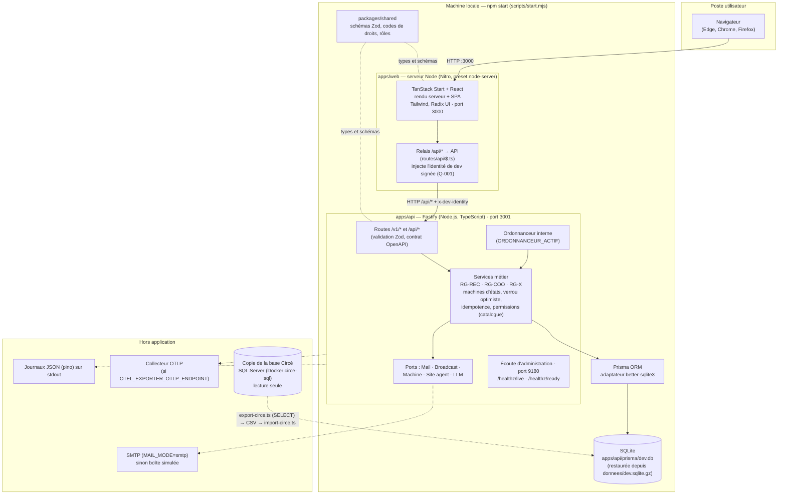
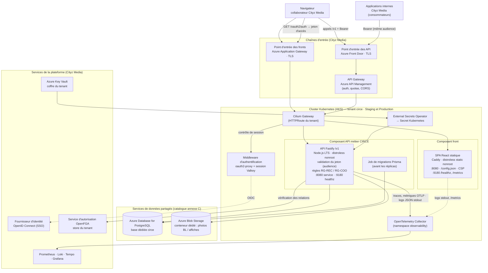
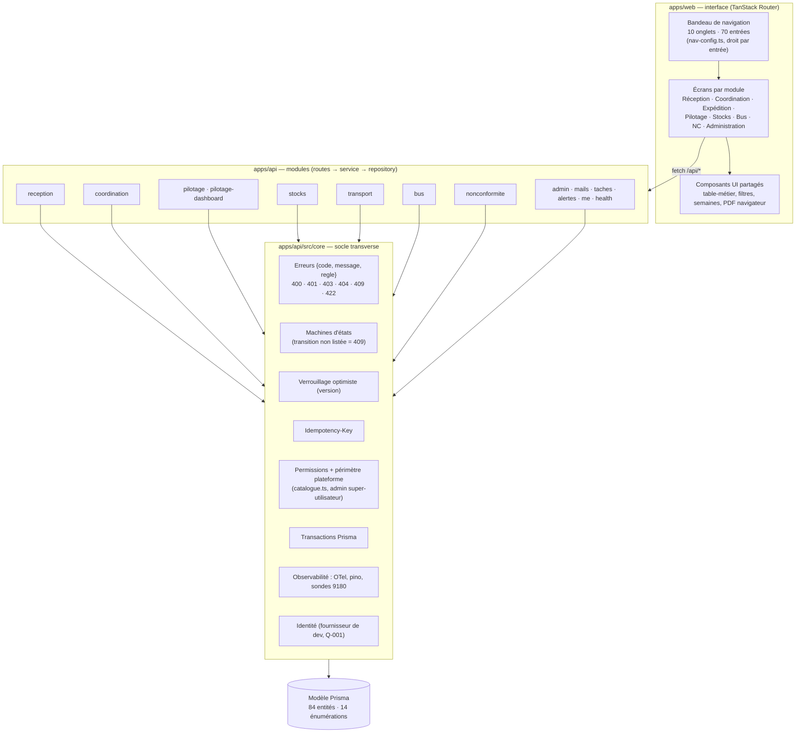
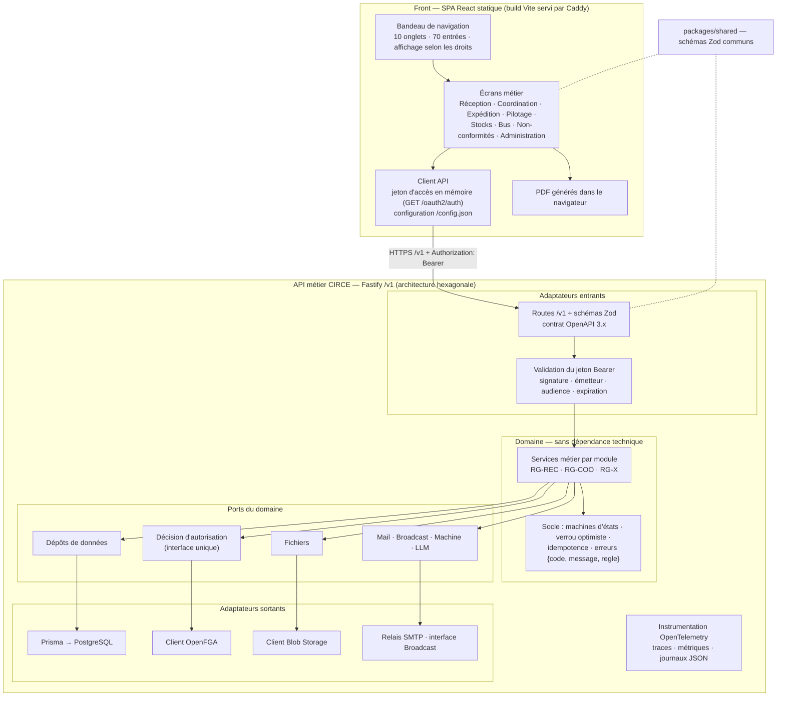
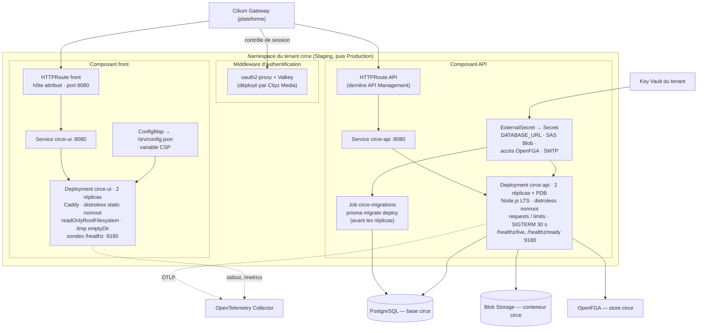
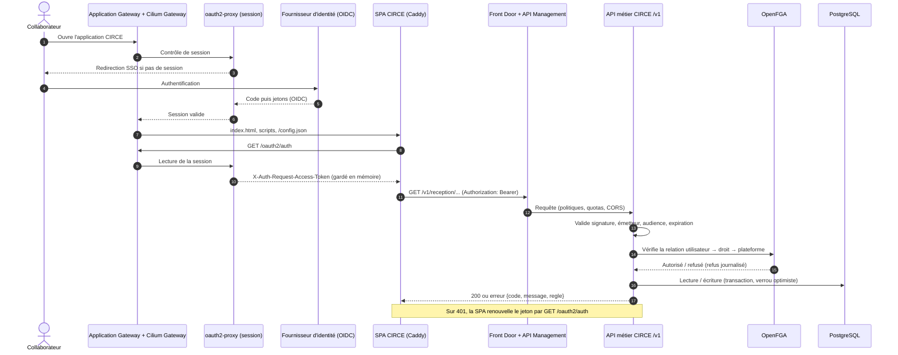
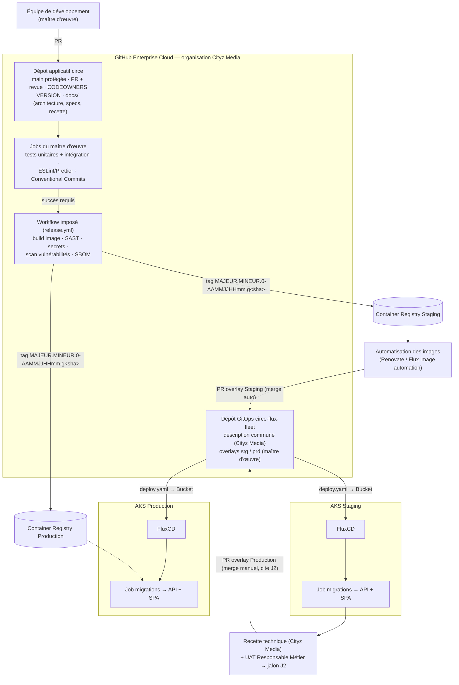

# Dossier d'architecture de CIRCE V2

> **Référentiel** : Cityz Media, DTSI — « Cadre de développement des applications métiers », référentiel technique
> 0.2.0-pre (version de travail, non contractuelle). Ce dossier répond à DOC-012 : chaque rubrique est traitée ; une
> rubrique sans objet est signalée avec sa justification.
>
> **Statut** : version initiale du 26/11/2026, **à soumettre à l'approbation de Cityz Media** (CAD-020, DOC-010,
> DOC-011). Approbation : [À COMPLÉTER : nom, date].
>
> **Lecture** : chaque rubrique distingue l'**état actuel** (ce que le dépôt exécute aujourd'hui, en local) et la
> **cible** (l'application déployée sur la plateforme Multi-tenant de Cityz Media). Les écarts entre les deux sont
> couverts par des dérogations demandées (`../exceptions/`) ; ils ne sont pas présentés comme résolus.
>
> **Sources** : `AGENTS.md`, `docs/AUDIT_STANDARDS_CITYZ_0_2_0_PRE.md`, `docs/ANALYSE_ARCHITECTURE_EXISTANTE.md`,
> `docs/EVOLUTION_API_OBSERVABILITE_2026_11_12.md`, `docs/operations/observabilite.md`, `docs/api/README.md`,
> `docs/RAPPORT_TESTS.md`, le code (`apps/api/src/core`, `apps/api/src/server-runtime.ts`, `scripts/start.mjs`) et
> le dossier d'architecture cible au format Word du 25/11/2026 (hors dépôt, `livrables/architecture/`), dont les
> sources Mermaid sont reprises ici.

## Sommaire

1. [Vue d'ensemble](#1-vue-densemble)
2. [Périmètre](#2-périmètre)
3. [Exigences non fonctionnelles](#3-exigences-non-fonctionnelles)
4. [Stack](#4-stack)
5. [Packaging](#5-packaging)
6. [Tenant](#6-tenant)
7. [Réseau](#7-réseau)
8. [Services tiers](#8-services-tiers)
9. [API](#9-api)
10. [Sécurité](#10-sécurité)
11. [Secrets](#11-secrets)
12. [Données](#12-données)
13. [Archivage](#13-archivage)
14. [Exceptions](#14-exceptions)
15. [Dérogations](#15-dérogations)
16. [Sources des schémas](#16-sources-des-schémas)

---

## 1. Vue d'ensemble

Exigences : CAD-020, MNT-013.

### 1.1 Composants

| Composant | État actuel | Cible |
|---|---|---|
| Front (`apps/web`) | TanStack Start + React, rendu serveur et SPA, servi par un serveur Node (Nitro, preset `node-server`, `apps/web/vite.config.ts:24`). Le serveur relaie `/api/*` vers l'API (`apps/web/src/routes/api/$.ts`) et y injecte l'identité de développement signée. | SPA React statique (build Vite) servie par Caddy, image distroless `static` non root ; configuration d'environnement lue au runtime dans `/config.json` ; aucun relais serveur. |
| API métier (`apps/api`) | Fastify 5, Node.js 24, TypeScript ; mêmes routes sous `/v1` et sous le préfixe historique `/api` (`apps/api/src/app.ts`) ; écoute de service et écoute d'administration séparée (sondes). | Même code, publié sous `/v1` derrière l'API Gateway ; image distroless Node.js non root ; ports 8080 (service) et 9180 (administration). |
| Schémas partagés (`packages/shared`) | Schémas Zod, codes de droits et rôles, utilisés par le front et l'API. | Inchangé. |
| Base de données | SQLite, fichier local `apps/api/prisma/dev.db` via Prisma et l'adaptateur `better-sqlite3` (décision Q-343). Au premier démarrage, la base livrée `apps/api/prisma/donnees/dev.sqlite.gz` est restaurée (Q-446). | Azure Database for PostgreSQL, base dédiée `circe` dans l'instance partagée. |
| Fichiers (photos de BL et d'affiches, pièces de non-conformité) | Octets en base (`Photo.fichier`, `NonConformiteFichier.contenu`), Q-311. | Azure Blob Storage, conteneur dédié, servi par l'API. |
| Identité | Fournisseur de développement uniquement (`IDENTITY_PROVIDER=dev`) : en-tête `x-dev-identity` signé HMAC (`apps/api/src/core/identity.ts`) ; démarrage refusé si `NODE_ENV=production` (`apps/api/src/core/config.ts`). Q-001. | SSO OpenID Connect conduit par oauth2-proxy ; l'API valide le jeton Bearer (signature JWKS, émetteur, audience, expiration). |
| Autorisation | Décision dans l'API à partir du catalogue local des droits et des rôles/périmètres en base (`apps/api/src/core/permissions/`). Modèle OpenFGA versionné et généré, sans appel au service. | Décision par appel au service OpenFGA du tenant, derrière l'interface unique `assertPermission` / `assertPlateforme`. |
| Traitements planifiés | Ordonnanceur interne dans le processus API (`apps/api/src/modules/taches/service.ts`, pulsation toutes les 30 s, `ORDONNANCEUR_ACTIF`) et planificateur Broadcast (ne démarre pas : aucune source configurée). | Hors périmètre du référentiel (CAD-001) ; mode d'exécution à cadrer avec Cityz Media (voir §2). |
| Observabilité | SDK OpenTelemetry officiel, journaux pino JSON sur stdout, sondes `/healthz/live` et `/healthz/ready` (`apps/api/src/core/observability/`). Export OTLP seulement si un collecteur est configuré. | Export vers le collecteur OpenTelemetry de la plateforme (Prometheus, Loki, Tempo, Grafana). |
| Livraison | Démarrage local `npm install` puis `npm start` (`scripts/start.mjs`). Aucun Dockerfile, Caddyfile, workflow de build ni overlay GitOps. | Workflow imposé par Cityz Media, registres Staging et Production, dépôt GitOps, FluxCD. |

### 1.2 Flux et dépendances

- **Actuel** : navigateur → serveur web Node (port 3000) → relais `/api/*` avec `x-dev-identity` → API Fastify
  (port 3001) → Prisma → SQLite. Sondes sur le port 9180. Reprise de données : `export-circe.ts` (SELECT seuls sur la
  copie SQL Server `circe-sql`) → CSV hors dépôt → `import-circe.ts` → SQLite.
- **Cible** : navigateur → Application Gateway → Cilium Gateway + oauth2-proxy → SPA ; la SPA obtient le jeton par
  `GET /oauth2/auth` puis appelle l'API par Front Door → API Management → Cilium Gateway → API `/v1`. L'API dépend de
  PostgreSQL, du Blob Storage, d'OpenFGA, des secrets du Key Vault (External Secrets) et du collecteur OpenTelemetry.

**Schéma de l'état actuel** (source : [actuel-1-architecture-actuelle.mmd](actuel-1-architecture-actuelle.mmd))

**Schéma de la cible** (source : [cible-1-vue-ensemble-cible.mmd](cible-1-vue-ensemble-cible.mmd))

### 1.3 Découpage hexagonal de l'API

MNT-013 est une recommandation (DEVRAIT) ; l'écart est justifié au §14.

**État actuel** : découpage par module (`apps/api/src/modules/<module>/{routes,service,repository,schemas,permissions}.ts`).
Les routes ne portent aucune logique métier ; les services portent les règles (RG-REC, RG-COO, RG-X). Le socle
transverse (`apps/api/src/core`) fournit erreurs normalisées, machines d'états, verrouillage optimiste, idempotence,
transactions et permissions. Des **ports** existent pour les dépendances externes (`apps/api/src/core/ports/` :
`mail.ts`, `broadcast.ts`, `machine.ts`, `site-agent.ts`, `llm-provider.ts`), avec des adaptateurs de développement ou
« non configuré ». En revanche, les services métier dépendent **directement** du client et des types Prisma (`Db`) :
il n'existe pas de port « dépôt de données » ni de port « fichiers », et le domaine n'est pas indépendant du pilote.

**Cible** : adaptateurs entrants (routes Fastify `/v1`, validation Zod, validation du jeton) ; domaine (services
métier et socle) sans dépendance technique ; ports (dépôts de données, décision d'autorisation, fichiers, mail,
Broadcast, machine, LLM) ; adaptateurs sortants (Prisma/PostgreSQL, client OpenFGA, client Blob Storage, relais SMTP,
interface Broadcast).

**Schéma applicatif actuel** (source : [actuel-2-architecture-applicative.mmd](actuel-2-architecture-applicative.mmd))

**Schéma applicatif cible** (source : [cible-2-architecture-applicative-cible.mmd](cible-2-architecture-applicative-cible.mmd))

---

## 2. Périmètre

Exigence : CAD-001. Le référentiel exclut de son périmètre (§2.2) les traitements batch et jobs planifiés, les
intégrations entre systèmes et les données personnelles au-delà de l'identité SSO. Les composants de CIRCE qui en
relèvent sont identifiés ici ; leur mode d'exécution cible reste à cadrer avec Cityz Media.

| Composant hors périmètre | Implémentation actuelle | Remarque |
|---|---|---|
| Ordonnanceur interne des traitements planifiés | `apps/api/src/modules/taches/service.ts` (`demarrerOrdonnanceur`, lancé par `apps/api/src/server-runtime.ts` si `ORDONNANCEUR_ACTIF=true`). Quatre tâches : fin de journée des colis (RG-COO-269), purge des réceptions attendues (RG-REC-180), Instruction OK automatique de rattrapage (RG-COO-042), envoi des mails en file (EX-TRA-030). Horaires dans les paramètres `taches.*` ; vides = tâche désactivée (Q-005, Q-410). Verrou persistant `tache_execution.verrou`. Commande manuelle `pnpm --filter @circe/api taches:executer`. | Dans le processus API : incompatible avec plusieurs réplicas sans coordination démontrée sur la base cible. Dérogation EXC-006. |
| Intégration Broadcast | Port `BroadcastPort` (`apps/api/src/core/ports/broadcast.ts`) ; adaptateur `BroadcastNonConfigure` ; planificateur `demarrerPlanificateur` (RG-COO-103) qui ne fait rien tant qu'aucune source n'est configurée (Q-005). | Contrat d'interface Broadcast inconnu. Flux sortant à déclarer (§7). |
| Envoi de mails | File d'envoi en base, port `MailPort` ; `MAIL_MODE=dev` (boîte d'envoi de développement, aucun mail réel) ou `smtp` (relais SMTP) ; D-19, Q-409. | Relais SMTP à déclarer (§7). |
| Machines d'impression (export des trains) | Port `MachinePort` (`machine.ts`), adaptateurs simulé ou non configuré. | Aucune machine réelle raccordée. |
| Reprise des données de Circé | Scripts `apps/api/scripts/export-circe.ts` et `import-circe.ts` (Q-437, Q-438). | Opération ponctuelle de migration de données, hors exécution courante. |
| Données personnelles | Identité de l'utilisateur (identifiant, nom) et adresses mail des destinataires de notifications. | Aucune donnée personnelle au-delà de l'identité et des contacts professionnels identifiée ; à confirmer par un document dédié si nécessaire. |

---

## 3. Exigences non fonctionnelles

Exigences : CAD-021, DON-050.

**Constat** : aucun cahier des charges avec des valeurs cibles mesurables (disponibilité, performance, sauvegarde,
PRA) n'est présent dans le dépôt ni dans les sources fournies. Les valeurs ci-dessous sont donc marquées « non
fixée ». Les seules mesures disponibles viennent des tests de volume et de la recette sur données réelles.

### 3.1 Volumétrie de référence

Reprise réelle de Circé (base de qualification, données du 07/07 au 07/10/2026, importée le 24/11/2026 ;
`docs/_travail/base-reelle-2026-11-24/00-SYNTHESE.md`, `docs/PLAN_IMPLEMENTATION.md`, journal du 24/11) :

| Donnée | Volume approximatif |
|---|---|
| Faces de train | ≈ 388 000 |
| Détails d'instruction | ≈ 357 000 |
| Unités de manutention (UM) | ≈ 39 000 |
| Colis | ≈ 12 900 |
| Affiches | ≈ 9 400 |

La base de dev correspondante occupe environ 220 Mo (SQLite), 38 Mo compressée (`dev.sqlite.gz`).

### 3.2 Tableau des ENF

| ENF | Valeur cible | Choix d'architecture | Moyen de vérification et jalon | Limites et risques résiduels |
|---|---|---|---|---|
| Temps de réponse des lectures | Non fixée [À COMPLÉTER : cahier des charges]. Seuil de travail des tests : 3 000 ms (`JDD_SEUIL_MS`), choix de test et non exigence. | Lectures groupées (pas de N+1), index en mémoire en une passe, statistiques du planificateur SQLite au démarrage (`optimiserStatistiques`, ANO-072). | `apps/api/test/massif/volume-reel.int.test.ts` ; mesures de la recette du 24/11 (ANO-065 à 074, `docs/RAPPORT_TESTS.md`) ; à rejouer sur Staging/PostgreSQL avant J2. | Mesures sur poste de développement et SQLite. Lectures encore lentes : ANO-075 (`/pilotage/dashboard` sans semaine, 6 à 15 s), ANO-080 (badge Alertes, 1,2 à 1,8 s, liste complète). |
| Temps de réponse des écritures en masse | Non fixée [À COMPLÉTER]. | Transactions, écritures par paquets (validation admin en lot, export des trains). | Lignes `PERF-024` du rapport de tests ; Staging avant J2. | API mono-fil : une lecture lourde retarde les autres requêtes (ANO-080). |
| Disponibilité, continuité de service | Non fixée [À COMPLÉTER]. | Cible : 2 réplicas + PodDisruptionBudget si la continuité est exigée (PLT-012) ; arrêt propre sur SIGTERM (sondes passées non prêtes, fermeture de Fastify et de la base). | Remplacement de nœud et arrêt sur Staging (J2). | Actuel : un seul processus, état local (SQLite, ordonnanceur) : plusieurs réplicas impossibles (EXC-001, EXC-006). |
| Sauvegarde et restauration (DON-050) | Objectifs RPO/RTO non fixés [À COMPLÉTER : cahier des charges] ; capacités de la plateforme [À COMPLÉTER : Cityz Media]. | Cible : sauvegardes de PostgreSQL et du Blob Storage par la plateforme. Mécanismes applicatifs complémentaires : idempotence des POST (`Idempotency-Key`), tâches idempotentes, import de reprise rejouable sur base vide, historiques de statut. | Exercice de restauration sur Staging avant production (EXP-042). | Actuel : aucune sauvegarde automatique ; copie du fichier `dev.db` seulement. |
| PRA | Non fixé [À COMPLÉTER]. | Repose sur la plateforme (redéploiement GitOps, restauration des données). | À définir. | — |
| Volumétrie | Volumes de la reprise (§3.1) comme référence ; croissance annuelle [À COMPLÉTER]. | Pagination côté serveur des listes ; lectures restreintes aux colonnes utilisées. | Tests de volume (`pnpm jdd --volume=…`, `volume-reel.int.test.ts`). | Pas de pagination sur les alertes (3,3 Mo à 6 000 dossiers). |

### 3.3 Temps mesurés lors de la recette sur données réelles (24/11/2026)

Mesures après correction, poste de développement, SQLite, base de dev aux données reprises (`docs/RAPPORT_TESTS.md`) :

| Anomalie | Requête | Avant | Après |
|---|---|---|---|
| ANO-065 | `GET /coordination/suivi-production` | API bloquée > 15 min | corrigé (index par clé de production) |
| ANO-066 | `GET /stocks/fin-campagne` | 32 s | 1,2 s |
| ANO-067 | `GET /pilotage/dashboard` | 50 s sans semaine | 6 à 10 s sans semaine, 1,5 s sur une semaine (reste ANO-075) |
| ANO-068 | `GET /coordination/rouleurs` | 15 s | 0,35 s |
| ANO-069 | `GET /pilotage/tableau` | 45 s | 2,0 s sur un site, 3,5 s tous sites |
| ANO-070 | `GET /coordination/unitaire` et `/synthese` | 12 s | 0,6 s |
| ANO-071 | `GET /alertes` | 5,5 s | 1,2 à 1,8 s |
| ANO-073 | `GET /coordination/trains/options-creation` | 19 s | 0,2 s |
| ANO-074 | `GET /pilotage/analyse` (période vide) | 4 s | 0,2 s |

---

## 4. Stack

Exigences : STK-001, STK-002, STK-011, STK-024. Versions lues dans les `package.json` le 26/11/2026.

| Élément | Version | Fin de support éditeur |
|---|---|---|
| Node.js (`.nvmrc`, `engines`) | 24 (LTS) | fin avril 2028 |
| TypeScript | 6.0.3 | [À VÉRIFIER] |
| pnpm (`packageManager`) | 12.14.0 | [À VÉRIFIER] |
| Fastify | 5.12.7 | [À VÉRIFIER : politique de support de la version majeure 5] |
| fastify-type-provider-zod | 7.0.0 | [À VÉRIFIER] |
| Zod | 4.6.7 | [À VÉRIFIER] |
| Prisma (client, CLI, adaptateur `better-sqlite3`) | 7.10.1 | [À VÉRIFIER] |
| better-sqlite3 | 12.11.1 | actuel uniquement ; retiré dans la cible PostgreSQL |
| SDK OpenTelemetry (`@opentelemetry/sdk-node`) | 0.301.1 (API 1.10.0) | [À VÉRIFIER] |
| React / React DOM | 19.3.1 | [À VÉRIFIER] |
| TanStack Router | 1.170.45 | [À VÉRIFIER] |
| TanStack Start | 1.169.3 | actuel uniquement (rendu serveur) ; la cible SPA n'en dépend plus (EXC-003) |
| Nitro | 3.0.260903-beta | actuel uniquement ; version bêta (EXC-003) |
| Vite | 8.3.4 | [À VÉRIFIER] |
| Tailwind CSS | 4.3.3 | [À VÉRIFIER] |
| Radix UI (dialog, popover, slot) | 1.3.1 / 1.3.1 / 1.5.0 | [À VÉRIFIER] |
| Vitest | 5.0.5 | outil de test |
| Playwright | 1.64.1 | outil de test |
| Caddy (cible) | ≥ 2.8, version exacte [À COMPLÉTER] | [À VÉRIFIER] |
| PostgreSQL (cible) | version fournie par Cityz Media [À COMPLÉTER] | [À COMPLÉTER] |

- Langages : TypeScript strict (API, front, schémas) ; JavaScript limité aux fichiers de configuration et aux scripts
  d'outillage (`scripts/*.mjs`).
- STK-011 : la date de fin de garantie du contrat n'est pas connue [À COMPLÉTER] ; la comparaison avec les dates de
  fin de support ne peut pas encore être faite.
- STK-024 (variante d'image .NET chiseled, mode de globalisation) : **sans objet**, l'application ne contient aucun
  composant .NET.

---

## 5. Packaging

Exigences : CIC-051, PLT-062, EXP-020, DON-030. Besoins exprimés pour la description commune du déploiement fournie
par Cityz Media.

### 5.1 Ports et sondes

| Composant | Port de service | Port d'administration | Sondes |
|---|---|---|---|
| API — actuel | `API_PORT`, défaut 3001 (`API_HOST` 127.0.0.1) | `ADMIN_PORT`, défaut 9180 | `/healthz/live` (processus seul), `/healthz/ready` (base, délai `ADMIN_READY_TIMEOUT_MS`, 503 pendant l'arrêt) |
| API — cible | 8080 | 9180 | mêmes sondes ; `startupProbe` si le démarrage mesuré sur Staging dépasse 30 s |
| Front — actuel | `WEB_PORT`, défaut 3000 (serveur Node) | aucun | aucune sonde |
| Front — cible | 8080 (Caddy) | 9180 (`/healthz`, `/metrics`) | sonde Caddy |

En local, `scripts/start.mjs` choisit un port libre si 3000, 3001 ou 9180 sont occupés. Le port 9180 ne doit jamais
être exposé par une HTTPRoute (EXP-022).

### 5.2 Ressources

Requests et limits CPU, mémoire et stockage éphémère : [À COMPLÉTER] après mesure sur Staging. Aucune mesure en
conteneur n'existe aujourd'hui. Indication : la base de dev aux données reprises occupe 220 Mo ; certaines lectures
lourdes produisent des réponses de plusieurs Mo (ANO-075, ANO-080).

### 5.3 Variables de configuration

API (`apps/api/src/core/config.ts`, validées au démarrage ; échec immédiat si invalides) :

| Variable | Rôle | Défaut | Secret |
|---|---|---|---|
| `NODE_ENV` | `development`, `test`, `production` | `development` | non |
| `LOG_LEVEL` | niveau pino | `info` | non |
| `API_HOST` / `API_PORT` | écoute de service | `127.0.0.1` / `3001` | non |
| `ADMIN_HOST` / `ADMIN_PORT` | écoute des sondes | `127.0.0.1` / `9180` | non |
| `ADMIN_READY_TIMEOUT_MS` | délai du contrôle de disponibilité | `2000` | non |
| `DATABASE_URL` | base de données ; aujourd'hui obligatoirement `file:…` (SQLite) | aucun (obligatoire) | oui dans la cible (identifiants PostgreSQL) |
| `IDENTITY_PROVIDER` | fournisseur d'identité ; seule valeur actuelle `dev` | `dev` | non |
| `DEV_IDENTITY_SECRET` | clé HMAC de l'identité de développement (16 caractères min.) ; obligatoire avec `dev` | aucun | oui (développement seulement, jamais déployé) |
| `MAIL_MODE` | `dev` (boîte simulée) ou `smtp` | `dev` | non |
| `SMTP_HOST`, `SMTP_PORT`, `SMTP_SECURE` | relais SMTP | —, `25`, `false` | non |
| `SMTP_USER`, `SMTP_PASSWORD` | identifiants SMTP (exigent `SMTP_SECURE=true`, Q-413) | aucun | oui |
| `MAIL_EXPEDITEUR` | adresse d'expédition | aucun | non |
| `ORDONNANCEUR_ACTIF` | active l'ordonnanceur interne | `true` | non |
| `OTEL_EXPORTER_OTLP_ENDPOINT`, `OTEL_EXPORTER_OTLP_PROTOCOL`, `OTEL_SERVICE_NAME`, `OTEL_RESOURCE_ATTRIBUTES`, autres `OTEL_*` standard | export OpenTelemetry ; aucun export sans endpoint | aucun | en-têtes OTLP éventuels : oui |

Front et outillage local (`.env.example`, `scripts/start.mjs`, `apps/web`) :

| Variable | Rôle | Cible |
|---|---|---|
| `API_URL` | URL de l'API pour le relais `/api/*` | supprimée ; l'URL de l'API est lue dans `/config.json` |
| `WEB_PORT` | port du serveur web local | remplacé par le port Caddy 8080 |
| `DEV_IDENTITY_USER` | utilisateur de développement injecté par le relais | supprimée (Q-001) |
| `CIRCE_EXPORT_DIR` | dossier hors dépôt des CSV de reprise (Q-437) | sans objet en exécution |
| `VITE_CACHE_DIR` | cache Vite des serveurs de test | sans objet en exécution |

Cible du front : un fichier unique `/srv/config.json` (URL de l'API, hôte d'authentification), monté depuis une
ConfigMap, et la variable CSP de l'overlay (STK-031, STK-032). Contenu exact [À COMPLÉTER] au portage SPA.

### 5.4 Job de migration

- **Actuel** : `pnpm db:up` exécute `apps/api/scripts/db.ts`, qui applique les migrations Prisma versionnées
  (`apps/api/prisma/migrations`, 31 migrations) sur le fichier SQLite par `prisma migrate deploy`.
- **Cible** : Job Kubernetes `circe-migrations`, **même image que l'API**, commande `prisma migrate deploy` (schéma
  `apps/api/prisma/schema.prisma` passé au provider PostgreSQL), exécuté avant les réplicas, avec les mêmes secrets
  que l'API. Les migrations SQLite actuelles devront être reprises pour PostgreSQL (EXC-001). Image [À COMPLÉTER :
  nom et registre fournis par le workflow imposé].

**Schéma de déploiement cible** (source : [cible-4-deploiement-kubernetes.mmd](cible-4-deploiement-kubernetes.mmd))

---

## 6. Tenant

Exigences : PLT-020, PLT-022, PLT-066, PLT-069.

| Sujet | Cible | État actuel |
|---|---|---|
| Namespaces | Un namespace du tenant `circe` par cluster (Staging, Production), portant le front, l'API, le Job de migration et l'ExternalSecret. Nom exact [À COMPLÉTER : Cityz Media]. Aucun namespace supplémentaire demandé. | Sans objet (exécution locale). |
| Ressources estimées par environnement | [À COMPLÉTER] après mesure sur Staging (CPU, mémoire, stockage éphémère, par composant). | Non mesurées. |
| Volumes persistants | **Aucun** : données en PostgreSQL, fichiers en Blob Storage. | Fichier SQLite persistant `apps/api/prisma/dev.db` (EXC-001). |
| Chemins en écriture à l'exécution | API : `/tmp` éventuel en `emptyDir`, à confirmer sur l'image [À VÉRIFIER]. Front : `/tmp` en `emptyDir` pour Caddy. Système de fichiers racine en lecture seule. | `apps/api/prisma/dev.db` et ses fichiers de journal SQLite ; `.env` créé par `scripts/start.mjs` ; caches de build (`.output`, cache Vite). L'API n'écrit aucun autre fichier (photos en base). |

---

## 7. Réseau

Exigences : PLT-030, PLT-035. Destinations sortantes propres à l'application, hors flux de la plateforme.

| Destination | FQDN | Port / protocole | Justification | Révocation non vérifiable |
|---|---|---|---|---|
| Relais SMTP (mails : colis expédié RG-COO-271, correction Broadcast RG-COO-057, déblocage RG-COO-147) | [À COMPLÉTER] | [À COMPLÉTER : 25, 465 ou 587] / SMTP (TLS si `SMTP_SECURE=true`) | Notifications métier (D-19, Q-409) | [À COMPLÉTER : refus proposé] |
| Interface Broadcast | [À COMPLÉTER] | [À COMPLÉTER] | Intégration des données de production (RG-COO-103), contrat inconnu (Q-005) | [À COMPLÉTER] |
| Machines d'impression / site agent | [À COMPLÉTER] ou sans objet | [À COMPLÉTER] | Export des trains vers les machines ; aucun raccordement réel aujourd'hui | [À COMPLÉTER] |

Flux de plateforme non listés ici : PostgreSQL, Blob Storage, OpenFGA, Key Vault, collecteur OpenTelemetry. Autorités
de certification ajoutées au magasin de confiance : **aucune** prévue.

État actuel : aucun flux sortant en exécution courante (mails en boîte simulée, Broadcast et machines non
configurés), hormis l'export OTLP si un collecteur est configuré.

---

## 8. Services tiers

Exigence : CAD-013.

**Aucun service tiers à souscrire à ce jour.** Les dépendances externes sont des services de la plateforme Cityz Media
(§7) ou des systèmes internes (Broadcast, relais SMTP). Le port `LlmProvider` (`apps/api/src/core/ports/llm-provider.ts`)
prévoit une API compatible chat/completions mais **n'est pas utilisé** ; son activation nécessiterait une souscription
par Cityz Media et une mise à jour de ce dossier.

---

## 9. API

Exigences : PLT-050, PLT-053, PLT-056.

| API | Classement proposé | Justification | Contrat |
|---|---|---|---|
| API CIRCE `/v1` (197 chemins, 224 opérations, version de contrat 1.0.0) | **API métier** | Expose les ressources métier (réceptions, affiches, stocks, instructions, trains, UM, colis, non-conformités, Bus, référentiels) et porte les règles RG. Consommée par la SPA ; peut l'être par d'autres applications internes. Publiée sur l'API Gateway. | [`docs/api/circe-v1.openapi.json`](../api/circe-v1.openapi.json) |
| API d'administration (sondes `/healthz/live`, `/healthz/ready`, port 9180) | **API technique** | Réservée à la plateforme (sondes Kubernetes) ; jamais publiée ni exposée par une HTTPRoute. | [`docs/api/circe-admin.openapi.json`](../api/circe-admin.openapi.json) |
| Préfixe historique `/api/*` | Transitoire | Mêmes gestionnaires que `/v1`, utilisé par le front actuel via le relais. À retirer avec le portage SPA. | — |

- Le contrat est généré depuis les routes et les schémas Zod (`pnpm api:contract`, contrôle `pnpm api:contract:check`,
  test `apps/api/test/api-version.int.test.ts`). L'extension `x-api-category` marque chaque opération (`business` ou
  `technical`, `apps/api/src/core/openapi.ts`).
- Les agrégations propres à un écran (tableaux de bord, synthèses) restent dans l'API métier ; leur éventuel
  isolement en API technique est à décider au cadrage.
- Besoins de politiques de l'API Gateway (PLT-053) : validation du jeton (audience), CORS limité à l'origine du front
  CIRCE, quotas [À COMPLÉTER], aucune transformation. Consommateurs internes connus : la SPA CIRCE ; autres
  [À COMPLÉTER].
- Concurrence et rejeu : `Idempotency-Key` sur les POST de création et de transition ; filtre de centre par l'en-tête
  `x-site-id`.

---

## 10. Sécurité

Exigences : SEC-014, SEC-022, SEC-043, SEC-050.

| Sujet | Cible | État actuel |
|---|---|---|
| Audience | API métier `/v1` : audience = ressource des API de l'environnement [À COMPLÉTER : valeur fournie par Cityz Media]. API technique : aucune audience (non exposée). | Aucun jeton Bearer : identité de développement `x-dev-identity` signée HMAC (EXC-002). |
| CORS | Porté par l'API Management, origine du front CIRCE uniquement ; l'API Fastify ne gère pas CORS (PLT-054, PLT-055). | Aucun CORS : le front appelle l'API par le relais de même origine. |
| Consommateurs tiers de l'API métier | Aucun connu [À COMPLÉTER]. | — |
| Modèle d'autorisation | OpenFGA, store du tenant. Types `utilisateur`, `role`, `plateforme`, `application` ; une relation par droit ; vérification par opération : `check(utilisateur, <droit>, application:circe)` puis, pour une ressource rattachée à un site, `check(utilisateur, perimetre, plateforme:<id>)`. L'administrateur est super-utilisateur et couvre toutes les plateformes (Q-421). | Modèle versionné : [`apps/api/authz/modele.fga`](../../apps/api/authz/modele.fga) et [`apps/api/authz/relations-roles.json`](../../apps/api/authz/relations-roles.json), générés par `pnpm --filter @circe/api authz:generer` depuis `apps/api/src/core/permissions/catalogue.ts` (source unique) ; synchronisation vérifiée par `apps/api/test/modele-autorisation.int.test.ts`. Décision encore calculée localement (`assertPermission`, `assertPlateforme` dans `apps/api/src/core/permissions/permissions.ts`) : aucun appel au service OpenFGA (SEC-020, SEC-021 à traiter). |
| CSP (SEC-040 à 043) | Fournie par la variable CSP de Caddy : `default-src 'self'; script-src 'self'; style-src 'self' 'unsafe-inline'; img-src 'self' data: blob:; connect-src 'self' <hôte de l'API Gateway>; object-src 'none'; base-uri 'self'; form-action 'self'; frame-ancestors 'none'`. Domaine autorisé dans `connect-src` : hôte de l'API Gateway [À COMPLÉTER]. | **Non appliquée** : le rendu serveur de TanStack Start injecte des scripts inline, incompatibles avec un `script-src` sans `'unsafe-inline'` (EXC-003). |
| Opérations sensibles journalisées (SEC-050, SEC-051) | Même mécanisme, journaux exportés vers Loki. | En place : événements `securite.refus` (refus d'autorisation) et `securite.operation_sensible` (écritures d'administration, de paramétrage et de référentiels, validation admin, déblocages, exports et suppressions de trains, rebut, mouvements manuels, fin de campagne, toute suppression), avec l'identité de l'utilisateur, sans cookie ni jeton (`apps/api/src/core/observability/securite-metier.ts`). |
| Jetons côté navigateur (SEC-015) | Jeton gardé en mémoire uniquement, renouvelé sur 401 par `GET /oauth2/auth`. | Aucun jeton stocké. Le `sessionStorage` ne contient que des données d'interface (panier, centre choisi). |
| Masquage des journaux | En-têtes `authorization`, `cookie`, `set-cookie` et identité de développement masqués par pino ; spans filtrés (pas de SQL, corps ni jeton). | Identique. |
| Contexte d'exécution (SEC-060 à 062) | Profil `restricted`, non root, aucune capability, seccomp `RuntimeDefault`, `automountServiceAccountToken: false`. | Sans objet (aucun conteneur, EXC-004). |

**Séquence d'authentification cible** (source : [cible-3-sequence-authentification.mmd](cible-3-sequence-authentification.mmd))

---

## 11. Secrets

Exigence : SEC-030. Nom et type uniquement ; aucune valeur dans le dépôt.

| Secret | Type | Consommateur | Remarque |
|---|---|---|---|
| Identifiants PostgreSQL (dans `DATABASE_URL`) | Infrastructure | API, Job de migration | cible |
| Signature d'accès partagé (SAS) du conteneur Blob | Infrastructure | API | cible |
| Accès au service OpenFGA | Infrastructure | API | cible |
| Secret de cookie oauth2-proxy | Infrastructure | Middleware d'authentification (Cityz Media) | cible |
| `SMTP_USER` / `SMTP_PASSWORD` (si le relais l'exige) | Applicatif | API | cible et actuel (optionnel) |
| En-têtes d'authentification OTLP (si le collecteur l'exige) | Infrastructure | API | [À COMPLÉTER] |
| `DEV_IDENTITY_SECRET` | Applicatif, développement seulement | API et relais web locaux | jamais déployé ; disparaît avec l'identité de développement (EXC-002) |

Cible : Key Vault du tenant synchronisé par External Secrets Operator en Secret Kubernetes ; rotation sans
reconstruction d'image (SEC-031, DON-010).

---

## 12. Données

Exigences : DON-003, DON-021, DON-022, DON-035.

| Sujet | Cible | État actuel |
|---|---|---|
| Services utilisés | Azure Database for PostgreSQL (base dédiée `circe`), Azure Blob Storage. | SQLite local (EXC-001). |
| Conteneurs | Un conteneur Blob dédié pour les photos de BL et d'affiches et les pièces jointes de non-conformité ; nom [À COMPLÉTER]. | Aucun : fichiers en base. |
| Fichiers (DON-040) | Port « Fichiers » + adaptateur Blob Storage introduits au passage à PostgreSQL ; clé = identifiant de la photo ; servis par l'API, jamais publics ; **sans changement de règle**. | **Non implémenté** : les photos restent en base (`Photo.fichier`, module Réception gelé, RG-REC-026 et RG-REC-027, Q-311). Dérogation EXC-001 (qui couvre aussi DON-003 et DON-040). |
| Modèle | 84 modèles et 14 énumérations Prisma (`apps/api/prisma/schema.prisma`), portés sur PostgreSQL ; mécanismes propres à SQLite (index uniques partiels, concurrence) réalisés par les moyens natifs de PostgreSQL. | Provider `sqlite`, adaptateur `better-sqlite3`. |
| Extensions PostgreSQL (DON-021) | **Aucune** identifiée à ce jour ; à confirmer lors du portage [À VÉRIFIER]. | Sans objet. |
| Pool de connexions (DON-022) | Taille maximale par réplica configurable par variable d'environnement ; valeur [À COMPLÉTER] selon le nombre de réplicas et la capacité de l'instance partagée. | Sans objet (connexion SQLite unique). |
| Migrations | Versionnées, en ajout seul, compatibles n-1 ; une migration appliquée n'est jamais modifiée ; Job avant les réplicas (DON-030 à 036). | 31 migrations SQLite dans `apps/api/prisma/migrations`. |
| Échec de migration (DON-035) | Détection, reprise ou retour à l'état antérieur, données à restaurer et conditions de redéploiement : voir [`docs/operations/migrations.md`](../operations/migrations.md). | Idem. |
| Jeux de données | Staging alimenté par des JDD fictifs (DOC-024). | Base de dev livrée avec des données reprises de Circé (Q-446) : écart déclaré EXC-007. |
| Concurrence | Verrouillage optimiste (`version`), transactions, idempotence. | Idem ; sur SQLite les écritures sont sérialisées. |

---

## 13. Archivage

Exigences : DON-060, DON-061, DON-062, DON-063.

**Aucune politique d'archivage n'est définie à ce jour.** Les durées ont un effet métier : elles doivent être
établies avec les Directions métiers et approuvées par le Responsable Métier, pas fixées pendant la migration
technique. La seule règle existante est fonctionnelle : la purge des réceptions attendues (RG-REC-180), qui n'est pas
une politique d'archivage. La rétention des photos n'est pas définie (EX-TRA-042, Q-311).

| Catégorie | Conservation active | Conservation en archive et fondement | Sort final |
|---|---|---|---|
| Réceptions, affiches et mouvements de stock | [À COMPLÉTER] | [À COMPLÉTER] | [À COMPLÉTER] |
| Instructions, faces de train, trains, UM et colis | [À COMPLÉTER] | [À COMPLÉTER] | [À COMPLÉTER] |
| Photos de BL et d'affiches, pièces de non-conformité (stockage objet) | [À COMPLÉTER] | [À COMPLÉTER] | [À COMPLÉTER] |
| Historiques de statut et journal métier | [À COMPLÉTER] | [À COMPLÉTER] | [À COMPLÉTER] |
| Non-conformités | [À COMPLÉTER] | [À COMPLÉTER] | [À COMPLÉTER] |
| Utilisateurs et périmètres | [À COMPLÉTER] | [À COMPLÉTER] | [À COMPLÉTER : anonymisation proposée] |
| Référentiels et paramètres | durée de vie de l'application | sans objet | sans objet |
| Réceptions attendues | purge fonctionnelle existante (RG-REC-180) | [À COMPLÉTER] | suppression |

- Processus d'archivage (déclenchement, format, emplacement dans le stockage objet, suppression à échéance) :
  [À COMPLÉTER].
- Processus de restauration d'une archive (demandeur, délai, mode) : [À COMPLÉTER].
- Approbation de la politique : Responsable Métier [À COMPLÉTER : nom, date].

---

## 14. Exceptions

Écarts justifiés aux exigences DEVRAIT et besoins particuliers (PLT-055, MNT-013, SEC-062).

| Exigence | Situation | Justification |
|---|---|---|
| MNT-013 — architecture hexagonale | Partielle : ports pour les dépendances externes ; services liés au client Prisma. | Le portage PostgreSQL et Blob Storage introduira les ports « dépôts » et « fichiers » ; une réécriture intégrale des services n'est pas engagée pour préserver les règles métier testées (modules Réception et Coordination gelés le 19/11/2026, `ressources/gel/GEL_RECEPTION_COORDINATION_2026_11_19.json`). |
| DOC-007 — export SVG des schémas | Schémas fournis en Mermaid (sources `.mmd` et blocs intégrés), sans export SVG. | Un bloc Mermaid est rendu par l'outil de revue et vaut source et export (DOC-006). Export SVG à produire si Cityz Media le demande. |
| CIC-041 — digest à côté du tag dans le dépôt GitOps | Sans objet aujourd'hui (aucun dépôt GitOps). | À appliquer lors du renseignement des overlays. |
| PLT-055 — CORS dans la chaîne d'entrée | Conforme dans la cible (API Management). | — |
| SEC-062 — jeton de compte de service | Aucun besoin : `automountServiceAccountToken: false`. | L'API n'appelle pas l'API Kubernetes. |

Besoins particuliers : aucun jeton de compte de service, aucun accès privilégié, aucun volume persistant.

---

## 15. Dérogations

Dérogations demandées (cadre, section 8 ; CAD-100 à 102). Registre et contenu : [`docs/exceptions/`](../exceptions/).

| Dérogation | Exigences concernées | Objet |
|---|---|---|
| [EXC-001-sqlite](../exceptions/EXC-001-sqlite.md) | DON-001, DON-003, DON-020 à 022, DON-040 | Base SQLite locale et fichiers en base au lieu de PostgreSQL et Blob Storage (Q-343, Q-311). |
| [EXC-002-identite-developpement](../exceptions/EXC-002-identite-developpement.md) | SEC-010 à 013 | Identité de développement signée au lieu du SSO et du jeton Bearer (Q-001). |
| [EXC-003-front-serveur-node](../exceptions/EXC-003-front-serveur-node.md) | STK-002, STK-030 à 035, SEC-040 à 043 | Front servi par un serveur Node (TanStack Start, Nitro) au lieu d'une SPA statique Caddy ; CSP non applicable. |
| [EXC-004-conteneurs-ci-gitops](../exceptions/EXC-004-conteneurs-ci-gitops.md) | STK-020 à 035, SEC-060 à 062, CIC-001 à 065, CAD-031, CAD-080 | Absence d'images, de workflow imposé et de dépôt GitOps. |
| [EXC-005-code-en-francais](../exceptions/EXC-005-code-en-francais.md) | DOC-002 | Identifiants et commentaires du code en français. |
| [EXC-006-etat-local-ordonnanceur](../exceptions/EXC-006-etat-local-ordonnanceur.md) | PLT-060, PLT-061, CAD-001 | État local (fichier SQLite) et ordonnanceur interne au processus API. |
| [EXC-007-donnees-production-dans-le-depot](../exceptions/EXC-007-donnees-production-dans-le-depot.md) | DOC-024, FIN-020, CAD-022 | Base de dev versionnée contenant des données reprises de Circé (Q-438, Q-446). |

---

## 16. Sources des schémas

Sources Mermaid versionnées dans ce répertoire (DOC-006), copiées du dossier d'architecture du 25/11/2026 ; chaque
schéma est aussi intégré ci-dessus dans un bloc `mermaid`.

| Fichier | Contenu |
|---|---|
| [actuel-1-architecture-actuelle.mmd](actuel-1-architecture-actuelle.mmd) | Architecture actuelle (exécution locale) |
| [actuel-2-architecture-applicative.mmd](actuel-2-architecture-applicative.mmd) | Découpage applicatif actuel |
| [cible-1-vue-ensemble-cible.mmd](cible-1-vue-ensemble-cible.mmd) | Vue d'ensemble cible sur la plateforme Cityz Media |
| [cible-2-architecture-applicative-cible.mmd](cible-2-architecture-applicative-cible.mmd) | SPA et API hexagonale cibles |
| [cible-3-sequence-authentification.mmd](cible-3-sequence-authentification.mmd) | Connexion SSO, jeton et appel de l'API |
| [cible-4-deploiement-kubernetes.mmd](cible-4-deploiement-kubernetes.mmd) | Ressources du tenant dans un cluster |
| [cible-5-chaine-livraison-cible.mmd](cible-5-chaine-livraison-cible.mmd) | Construction, publication et promotion d'un build |

**Chaîne de livraison cible** (source : [cible-5-chaine-livraison-cible.mmd](cible-5-chaine-livraison-cible.mmd)) :
version `MAJEUR.MINEUR` dans `VERSION`, build `MAJEUR.MINEUR.0-AAMMJJHHmm.g<sha>`, même image de Staging à Production,
déploiement Production après le jalon J2, retour arrière par revert de l'overlay. Aucun de ces éléments n'existe
encore dans le dépôt (EXC-004).

